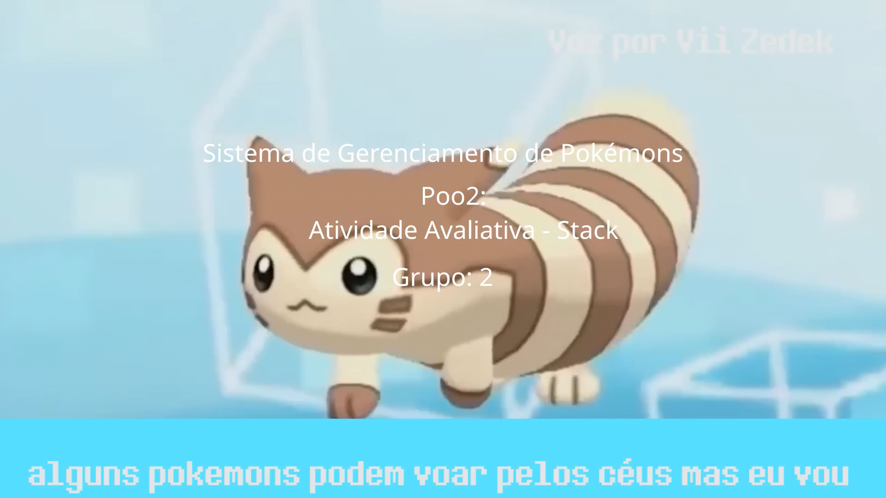
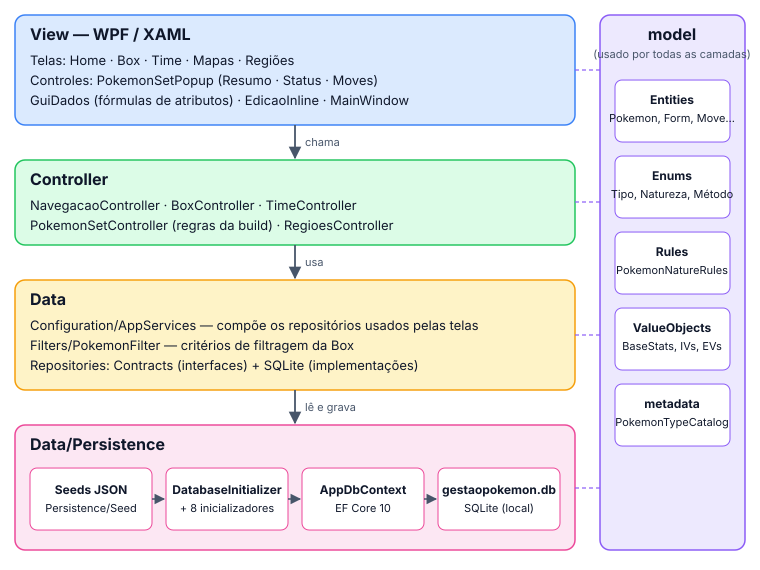
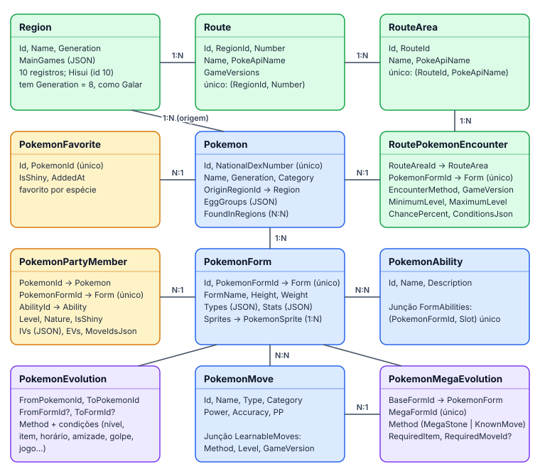

# Gestão de Pokémon

**Documentação do projeto** — aplicação desktop de Pokédex e montagem de time, desenvolvida em C#, WPF e .NET 10.

> **Esta documentação em PDF:** [docs/Documentacao_Gestao_de_Pokemon.pdf](docs/Documentacao_Gestao_de_Pokemon.pdf) — o mesmo conteúdo deste README, em formato de documento para leitura e impressão.

| | |
|---|---|
| **Projeto** | Gestão de Pokémon (`GestaoDePokemon`) |
| **Tipo** | Aplicação desktop para Windows: Pokédex, Box, Time e Mapas |
| **Tecnologias** | C# · .NET 10 · WPF/XAML · Entity Framework Core 10 · SQLite |
| **Repositório** | [Yukitto-dark/Gestao-de-Pokmon-](https://github.com/Yukitto-dark/Gestao-de-Pokmon-) |
| **Versão documentada** | branch `master`, commit `d926e26` ("Adição das rotas de paldeia e hisui") |
| **Autoria / disciplina** | _preencher_ |

## Sumário

1. [Vídeo de apresentação](#video)
2. [Visão geral](#visao-geral)
3. [Escopo e decisões de projeto](#escopo)
4. [Funcionalidades](#funcionalidades)
5. [Regras de negócio](#regras)
6. [Arquitetura](#arquitetura)
7. [Modelo de dados](#modelo-de-dados)
8. [Inicialização do banco e seeds](#inicializacao)
9. [Fontes de dados e scripts de geração](#fontes)
10. [Tecnologias](#tecnologias)
11. [Como executar](#como-executar)
12. [Testes e validação](#testes)
13. [Diagnóstico de problemas](#diagnostico)
14. [Limitações conhecidas](#limitacoes)
15. [Créditos e aviso legal](#creditos)
16. [Apêndice A — Glossário](#glossario)
17. [Apêndice B — Consultas SQL úteis](#consultas)

<a id="video"></a>

## 1. Vídeo de apresentação

<p align="center">
  <a href="COLE_AQUI_O_LINK_DO_VIDEO"></a>
</p>

**Link do vídeo:** COLE_AQUI_O_LINK_DO_VIDEO

<p align="center"><sub>Clique na imagem para abrir o vídeo.</sub></p>

<a id="visao-geral"></a>

## 2. Visão geral

O **Gestão de Pokémon** é uma aplicação desktop para consultar uma Pokédex completa e montar um time com a configuração de cada Pokémon: nível, natureza, IVs, EVs, habilidade e quatro golpes. A interface se inspira na organização visual dos jogos da franquia (tela inicial com áreas clicáveis, Box paginada, tela de time e mapas das regiões).

Todos os dados ficam em um banco **SQLite** local. Na primeira execução, o aplicativo cria o banco e o preenche a partir de arquivos JSON versionados no próprio repositório; depois disso, as inicializações apenas completam o que falta. O código-fonte não contém chamadas de rede (nenhum uso de `HttpClient`, `WebClient` ou `WebRequest`), portanto o aplicativo funciona totalmente offline.

### O projeto em números

Contagens obtidas dos arquivos de seed da branch `master` (commit `d926e26`).

| Item | Quantidade |
|---|---|
| Espécies | **1.025** (#001 Bulbasaur a #1025 Pecharunt) |
| Espécies por geração | I: 151 · II: 100 · III: 135 · IV: 107 · V: 156 · VI: 72 · VII: 88 · VIII: 96 · IX: 120 |
| Formas | **1.525** = 1.025 formas Normal + 500 alternativas (242 espécies têm ao menos uma forma alternativa) |
| Mega Evoluções | **96** (95 por Mega Pedra e 1 por golpe: Mega Rayquaza, com Dragon Ascent) |
| Habilidades | **313** |
| Golpes (catálogo) | **834** (335 físicos, 233 especiais e 266 de status) |
| Linhas de golpes por forma | cerca de **588 mil** nos seeds (244.285 das Gerações I–VI, 276.536 dos jogos da Geração VII em diante e 67.135 das formas alternativas) |
| Relações de evolução | **569** (527 por espécie e 42 por forma regional) |
| Regiões | **10** (Kanto, Johto, Hoenn, Sinnoh, Unova, Kalos, Alola, Galar, Paldea e Hisui) |
| Rotas | **218** rotas, 365 áreas e 30.475 encontros |
| Sprites | **5.976** arquivos PNG (cerca de 30 MB) |

<a id="escopo"></a>

## 3. Escopo e decisões de projeto

**O que o sistema faz**

- Exibe o catálogo completo (espécies e formas) com busca, filtros e paginação.
- Mostra, para cada forma, tipos, habilidades, atributos-base, altura, peso, linha evolutiva e golpes.
- Permite favoritar espécies e montar um time de até seis Pokémon, com build detalhada.
- Lista as rotas de cada região com os Pokémon encontrados, os jogos e as áreas.

**O que o sistema não faz (decisões deliberadas)**

- **Não simula jogos:** não há batalhas, capturas nem progressão. As evoluções são **dados de consulta**; o sistema não decide nem aplica evoluções.
- **Não edita o catálogo:** espécies, formas, golpes e rotas vêm dos seeds. O que o usuário altera é apenas o que lhe pertence: favoritos e time.
- **Não é multiplataforma:** a interface é WPF e o alvo é `net10.0-windows`. No Linux é possível compilar e executar via Wine (veja [Como executar](#como-executar)).

<a id="funcionalidades"></a>

## 4. Funcionalidades

### 4.1 Navegação e janela

A tela **Home** tem três áreas clicáveis que levam a **Time**, **Box** e **Mapas**. A navegação é feita pelo nome do botão (`NavegacaoController`). A janela usa uma barra de título própria (WindowChrome) com botões de minimizar, maximizar e fechar, aceita **F11** para tela cheia e usa um cursor personalizado.

### 4.2 Box (Pokédex)

A Box apresenta os Pokémon em uma **grade paginada de 6 × 5 (30 entradas por página)**. Cada entrada representa uma **forma**: a forma Normal de uma espécie aparece primeiro, seguida das demais formas cadastradas. Ao selecionar uma entrada, o painel lateral mostra o sprite de detalhe, os tipos, as habilidades, os atributos, a altura, o peso, a linha evolutiva, as formas e os golpes. Quando há sprite shiny, um botão alterna entre a aparência normal e a shiny.

| Recurso | Como funciona |
|---|---|
| Filtro por tipo | Os 18 tipos; vale para cada forma (Ninetales de Alola aparece em Ice/Fairy) |
| Filtro por região | Região de origem: Kanto, Johto, Hoenn, Sinnoh, Unova, Kalos, Alola, Galar, Hisui ou Paldea |
| Filtro por habilidade | Por nome da habilidade |
| Formas alternativas | Mostra só as espécies que têm formas alternativas |
| Favoritos | Marca ou desmarca uma **espécie** como favorita; o filtro lista apenas os favoritos |
| Time | O botão "Por na party" / "Remover da party" alterna a **forma** selecionada no time (até seis); o filtro lista apenas os membros do time |
| Número da Pokédex | Pesquisa pelo número nacional |
| Nome | Pesquisa pelo nome da espécie |

Os critérios são agrupados em `PokemonFilter` (tipos, regiões de origem, favoritos, time, número, nome, habilidade e formas alternativas).

### 4.3 Time e build do Pokémon

A tela **Time** mostra os seis membros com o ícone da forma escolhida (normal ou shiny). Clicar em um membro abre a **build** em três páginas:

| Página | Conteúdo |
|---|---|
| **Resumo** | Número, nível, HP calculado, habilidade (clique no nome para escolher entre as habilidades da forma, inclusive a oculta) e seletor de nível (botões `-`/`+` e barra, de 1 a 100); o HP é recalculado na hora e o nível é gravado quando a barra para. |
| **Status** | Para cada atributo: base stat da espécie, IV, valor final (calculado com nível, IV, EVs e natureza, como nos jogos) e EVs investidos. Clicar no IV edita o IV (0 a 31); clicar nos demais números edita os EVs (até 252 por atributo e 510 no total). Mostra também a natureza com seu efeito (clique nela para trocá-la), a altura e o peso. |
| **Moves** | Até quatro golpes, sem repetição, escolhidos entre os que a forma aprende (por nível, TM, tutor, ovo ou evolução); o catálogo inteiro não é oferecido. A página mostra poder e precisão do golpe selecionado e o PP de cada um. Os níveis exibidos vêm de um jogo de referência (o mais recente que tem dados para a forma). Enquanto nenhum golpe foi salvo, o Pokémon aparece com os quatro últimos golpes aprendidos por nível até o nível atual, como nos jogos; eles só são gravados na primeira edição. |

> **Exemplo:** um Garchomp de natureza Adamant, nível 100, com IV 31 e 252 EVs em Ataque aparece como `130 | 394 | +252` (base, valor final, EVs).

### 4.4 Mapas e regiões

A tela **Mapas** tem uma área clicável para cada uma das dez regiões e um botão para voltar à Home. A tela **Regiões** tem uma aba por região e lista as rotas com os Pokémon encontrados, os jogos e as áreas, lidos do SQLite (`rotas-seed.json`). Nas regiões de Kanto a Galar são as rotas dos jogos; em Paldea são os locais de Scarlet/Violet (províncias, lagos, mares, cavernas, cidades e a Área Zero) e, em Hisui, as cinco grandes áreas de Legends: Arceus com seus sublocais.

| Região | Rotas | Jogos principais |
|---|---|---|
| Kanto | 28 | Red, Blue, Yellow, FireRed, LeafGreen, Let's Go Pikachu/Eevee |
| Johto | 18 | Gold, Silver, Crystal, HeartGold, SoulSilver |
| Hoenn | 34 | Ruby, Sapphire, Emerald, Omega Ruby, Alpha Sapphire |
| Sinnoh | 30 | Diamond, Pearl, Platinum, Brilliant Diamond, Shining Pearl |
| Unova | 23 | Black, White, Black 2, White 2 |
| Kalos | 21 | X, Y, Legends: Z-A, Mega Dimension |
| Alola | 17 | Sun, Moon, Ultra Sun, Ultra Moon |
| Galar | 10 | Sword, Shield, The Isle of Armor, The Crown Tundra |
| Paldea | 32 | Scarlet, Violet, The Teal Mask, The Indigo Disk |
| Hisui | 5 | Legends: Arceus |

<a id="regras"></a>

## 5. Regras de negócio

| Regra | Valor | Onde está |
|---|---|---|
| Nível | de 1 a 100 | `PokemonSetController` |
| IV | de 0 a 31 por atributo | `IndividualValues` |
| EV | até 252 por atributo e **510 no total** | `EffortValues` |
| Natureza | 25 naturezas; uma aumenta um atributo em 10% e outra reduz outro em 10% (as neutras não alteram) | `PokemonNatureRules`, `NatureModifiers` |
| Golpes | no máximo 4, sem repetição, apenas golpes que a forma aprende | `PokemonSetController.AtualizarMoves` |
| Golpes padrão | os quatro últimos aprendidos por nível até o nível atual, enquanto nada foi salvo | `PokemonSetController` |
| Time | no máximo **6** membros no total; cada **forma** entra uma vez (formas diferentes da mesma espécie podem coexistir) | `PartySqliteRepository` (`MaximoMembros`), índice único em `PokemonFormId` |
| Favoritos | por **espécie** (um registro por espécie) | `IFavoritosRepository`, índice único em `PokemonId` |
| Evoluções | apenas informativas; uma evolução por forma regional vale só para aquela forma | `PokemonEvolution` |

**Cálculo dos atributos** (`View/Controles/GuiDados.cs`):

```csharp
// HP
HpMaximo = ((2 * baseHp + iv + ev / 4) * nivel / 100) + nivel + 10;

// Demais atributos
valor = (2 * baseStat + iv + ev / 4) * nivel / 100 + 5;
// natureza: +10% (valor * 110 / 100) ou -10% (valor * 90 / 100), com divisão inteira
```

<a id="arquitetura"></a>

## 6. Arquitetura

O código separa a interface, a lógica de aplicação, o acesso aos dados e o modelo de domínio, em uma organização de camadas no estilo MVC. O pacote `model` é compartilhado por todas as camadas.



### 6.1 Camadas

| Camada | Responsabilidade | Principais tipos |
|---|---|---|
| **View** | Telas XAML e controles; só exibe dados e repassa ações do usuário | `Home`, `Box`, `Time`, `Mapas`, `Regioes`, `PokemonSetPopup`, `GuiSummaryControl`, `GuiStatusControl`, `GuiMovesControl`, `GuiDados` |
| **Controller** | Regras de apresentação e de montagem da build | `NavegacaoController`, `BoxController`, `TimeController`, `PokemonSetController`, `RegioesController` |
| **Data** | Composição de serviços, filtros e repositórios | `AppServices`, `PokemonFilter`, `IPokemonRepository`, `IFavoritosRepository`, `IPartyRepository`, `IRotaRepository` e as implementações `*SqliteRepository` |
| **Data/Persistence** | Contexto do EF Core, inicialização do banco e seeds | `AppDbContext`, `DatabaseInitializer` e os inicializadores auxiliares |
| **model** | Entidades, enumerações, regras e objetos de valor | `Pokemon`, `PokemonForm`, `PokemonPartyMember`, `PokemonNatureRules`, `BaseStats`, `EffortValues` |

Os repositórios são selecionados por `AppServices`: Pokédex, favoritos, time e rotas usam SQLite. As interfaces ficam em `Data/Repositories/Contracts`, o que mantém os controladores independentes da implementação.

### 6.2 Estrutura de pastas

```text
GestaoDePokmon-/
├── Controller/                 # Controladores das telas e navegação
├── Data/
│   ├── Configuration/          # Composição dos serviços e repositórios (AppServices)
│   ├── Filters/                # Critérios de filtragem da Pokédex
│   ├── images/pokemon/         # Sprites (frontNormal, frontShiny, mini, miniShiny e forms)
│   ├── Persistence/
│   │   ├── Initialization/     # Inicialização do banco e importação dos seeds
│   │   ├── Seed/               # Dados JSON versionados
│   │   ├── Sql/                # Consultas SQL de validação
│   │   └── AppDbContext.cs     # Contexto do Entity Framework Core
│   └── Repositories/
│       ├── Contracts/          # Interfaces e contratos
│       └── SQLite/             # Repositórios persistidos
├── model/
│   ├── Entities/               # Entidades do domínio
│   ├── Enums/                  # Enumerações
│   ├── Rules/                  # Regras do domínio
│   ├── ValueObjects/           # Objetos de valor
│   └── metadata/               # Catálogos e metadados
├── View/
│   ├── Telas/                  # Páginas XAML (Home, Box, Time, Mapas, Regiões)
│   ├── Controles/              # Popup da build do Pokémon (Resumo, Status e Moves)
│   ├── images/                 # Ícones de tipos e da interface
│   ├── fonts/                  # Fontes utilizadas na interface
│   └── cursors/                # Cursores personalizados
├── App.xaml / App.xaml.cs
├── MainWindow.xaml / MainWindow.xaml.cs
├── GestaoDePokemon.csproj
└── GestaoDePokemon.slnx
```

### 6.3 Ciclo de vida do aplicativo

1. `App.xaml.cs` chama `DatabaseInitializer.Inicializar()` ao iniciar.
2. Se o inicializador registrar avisos (por exemplo, rotas não importadas), eles são exibidos ao usuário e o aplicativo abre normalmente.
3. Se a inicialização falhar, o erro (com o nome da etapa e as mensagens internas do SQLite) é gravado em `erro-banco.txt`.
4. Um erro inesperado em uma tela não fecha o aplicativo: é registrado em `erro-app.txt`.

Os arquivos de log ficam em `%LOCALAPPDATA%\GestaoDePokemon`, a mesma pasta do banco.

<a id="modelo-de-dados"></a>

## 7. Modelo de dados

O contexto `AppDbContext` mapeia as entidades abaixo para o arquivo `gestaopokemon.db`. Listas e objetos de valor (tipos, atributos, grupos de ovo, IVs) são gravados como **JSON** em uma coluna de texto, por conversores de valor do EF Core.



### 7.1 Entidades

| Entidade (tabela) | Descrição |
|---|---|
| `Pokemon` (`Pokemons`) | Espécie: número nacional (único), nome, geração, categoria, região de origem e grupos de ovo |
| `PokemonForm` (`PokemonForms`) | Forma de uma espécie: nome, tipos, atributos-base, altura e peso. Toda espécie tem uma forma `Normal` |
| `PokemonSprite` (`Sprites`) | Caminhos dos sprites da forma: arte de exibição, ícone da Box e as versões shiny |
| `PokemonAbility` (`Abilities`) | Catálogo de habilidades |
| `PokemonFormAbility` (`FormAbilities`) | Habilidades de cada forma por slot (`First`, `Second`, `Hidden`); único por (forma, slot) |
| `PokemonMove` (`Moves`) | Golpe: tipo, categoria (`Physical`, `Special`, `Status`), poder, precisão e PP |
| `LearnableMove` (`LearnableMoves`) | Golpe que uma forma aprende, com método (`LevelUp`, `TM`, `Egg`, `Tutor`, `Evolution`), nível e jogo |
| `PokemonEvolution` (`Evolutions`) | Relação de evolução entre espécies, com condições e, opcionalmente, formas de origem e destino |
| `PokemonMegaEvolution` (`MegaEvolutions`) | Liga a forma base à forma Mega, com Mega Pedra ou golpe exigido; a forma Mega é única |
| `Region` (`Regions`) | Região: nome (único), geração e jogos principais |
| `Route` / `RouteArea` / `RoutePokemonEncounter` | Rotas de uma região, suas áreas e os encontros (método, níveis, chance e jogo) |
| `PokemonFavorite` (`Favorites`) | Espécie favorita (única por espécie) |
| `PokemonPartyMember` (`Party`) | Membro do time e sua build |
| `PokemonFoundInRegion` | Tabela de junção N:N entre espécies e regiões onde são encontradas (sem classe própria; criada pelo mapeamento do EF Core) |

### 7.2 Time (`Party`)

Cada linha guarda a forma escolhida (`PokemonFormId`, único), a espécie, o nível, a natureza (como texto), a habilidade, os IVs (JSON), os EVs (colunas `EV_HP`, `EV_Attack`, `EV_Defense`, `EV_SpecialAttack`, `EV_SpecialDefense` e `EV_Speed`), os identificadores dos golpes (`MoveIdsJson`), o indicador shiny e a data de inclusão.

### 7.3 Evoluções

`PokemonEvolution` guarda o método (`LevelUp`, `UseItem`, `Trade`, `Friendship`, `Beauty`, `KnowMove`, `AtLocation` ou `Other`) e as condições que o modelo sabe representar: nível, item, item segurado, horário, amizade, beleza, gênero, local, golpe, espécie na equipe, espécie na troca, tipo na equipe, tipo do golpe, comparação entre Ataque e Defesa, afeição, passos, contagem mínima de golpes (`MinimumMoveCount`), chuva, virar o console de cabeça para baixo, espaço livre na equipe, Poké Ball na bolsa e o jogo.

**Evoluções por forma.** As colunas opcionais `FromFormId` e `ToFormId` restringem uma linha a uma forma: só o Meowth de Galar evolui para Perrserker, e só o Rattata de Alola evolui para o Raticate de Alola. Regra de consulta para uma forma **F**: use as linhas com `FromFormId = F.Id`; se não houver nenhuma, use as de `FromFormId` nulo. `ToFormId` informa qual forma resulta (Exeggcute → Exeggutor de Alola).

### 7.4 Regras de integridade

- `NationalDexNumber` é único em `Pokemons`; `Region.Name` é único; `Route` é único por (região, número); `RouteArea` é único por (rota, nome na PokéAPI).
- A exclusão de uma espécie remove, em cascata, suas formas (com sprites, habilidades e golpes), favoritos, membros do time e a junção de regiões. Encontros em rotas, evoluções e a região de origem usam `Restrict` e impedem a exclusão; o mesmo vale para as Mega Evoluções e para a habilidade escolhida no time.
- Cada forma Mega tem no máximo uma relação em `MegaEvolutions` (índice único em `MegaFormId`).

<a id="inicializacao"></a>

## 8. Inicialização do banco e seeds

### 8.1 Princípios

- **Banco criado por `EnsureCreated()`**, sem migrations. Como `EnsureCreated()` não altera tabelas existentes, o `DatabaseInitializer` executa **atualizações de esquema manuais e idempotentes** (`Ensure*`) para que bancos criados por versões anteriores ganhem colunas e índices novos sem perder favoritos nem o time.
- **Importação incremental:** os seeds só inserem o que falta e nunca duplicam registros; reexecutar a inicialização é seguro.
- **Transação única:** a carga dos seeds ocorre em uma transação, confirmada na etapa final.
- **Rotas não são essenciais:** se a importação das rotas falhar, o erro vira um aviso, a gravação daquela etapa é desfeita e o aplicativo abre mesmo assim.
- **Mensagens de erro úteis:** qualquer falha é reportada com o nome da etapa e a cadeia de exceções internas.

### 8.2 Atualizações de esquema

Antes da carga dos dados, são executadas, nesta ordem: `EnsureRouteSchema`, `EnsurePartySchema`, `EnsureShinyColumns`, `EnsureSetColumns`, `EnsurePartyFormSchema`, `MigrarEVsPadrao`, `EnsureFormMeasurementsSchema`, `MigrateLegacySpritePaths`, `EnsureEvolutionSchema` e `EnsureMegaEvolutionSchema`.

### 8.3 Etapas da carga (dentro da transação)

| # | Etapa | O que faz |
|---|---|---|
| 1 | Regiões | Cadastra as 10 regiões (Hisui tem geração 8, como Galar) |
| 2 | Espécies | Insere as 1.025 espécies; as espécies #899–#905 (Legends: Arceus) têm Hisui como região de origem |
| 3 | Atributos base | Repara formas sem atributos válidos, sem sobrescrever os corretos |
| 4 | Correção de dados antigos | `NormalizeLegacyPokedexData` e `CorrectKnownBaseStats` (atributos de Charizard, Blastoise e Beedrill) |
| 5 | Habilidades | Catálogo e slots (1, 2 e oculta) |
| 6 | Sprites | Caminhos dos sprites das formas Normal |
| 7 | Golpes e learnsets | Catálogo de golpes e learnsets das Gerações I–VI |
| 8 | Evoluções | Relações por espécie |
| 9 | Formas de Kyurem | Formas alternativas de Kyurem |
| 10 | Formas das Gerações I a V | Formas alternativas, com habilidades, sprites e golpes |
| 11 | Formas da Geração VI | Formas de Kalos e demais formas até a Geração VI |
| 12 | Megas da Geração VI | Formas Mega de X/Y e Omega Ruby/Alpha Sapphire |
| 13 | Formas de Alola, Galar, Hisui e Paldea | Inclusive formas regionais de espécies antigas |
| 14 | Megas de Legends: Z-A | Formas Mega do jogo |
| 15 | Evoluções por forma | Evoluções que só valem para uma forma regional |
| 16 | Mega Evoluções | Relação forma base → forma Mega (Mega Pedra ou golpe) |
| 17 | Golpes da Geração VII em diante | Learnsets por jogo, em formato compacto |
| 18 | Rotas | Rotas, áreas e encontros (etapa opcional) |
| 19 | Jogos das regiões | Completa `Region.MainGames` com o nome de cada jogo |
| 20 | Ícones da Box | Formas com ícone próprio passam a usá-lo |
| 21 | Ícones shiny da Box | Preenche `BoxShiny` por convenção de pasta, só se o arquivo existir |
| 22 | Altura e peso | Atualiza medidas depois que todas as formas existem |
| 23 | Formas do time | Membros antigos do time passam a apontar para a forma Normal |
| 24 | Gravação final | Confirma a transação |

> **Primeira execução:** a carga importa cerca de 590 mil linhas de golpes e pode demorar; a estimativa dos scripts de importação para a parte mais recente (cerca de 280 mil linhas) é de alguns segundos a cerca de um minuto. As inicializações seguintes são mais rápidas, pois só inserem o que falta.

### 8.4 Arquivos de seed

Ficam em `Data/Persistence/Seed/`. O `pokemon-seed.json` é um **recurso embutido** no executável; os demais são copiados para a saída do build.

| Arquivo | Conteúdo | Registros |
|---|---|---|
| `pokemon-seed.json` | Espécies: nome, geração, categoria, grupos de ovo e a forma Normal (tipos e atributos) | 1.025 |
| `abilities-seed.json` | Catálogo de habilidades e slots por espécie | 313 habilidades |
| `move-catalog-seed.json` | Catálogo de golpes | 834 |
| `pokemon-learnsets-seed.json` | Golpes das Gerações I–VI (#001–#721), 14 grupos de jogos | 244.285 linhas |
| `generation-vii-ix-learnsets-seed.json` | Golpes por jogo (formato compacto), 9 grupos de jogos | 5.171 entradas (276.536 linhas) |
| `generation-i-v-forms-seed.json` | Formas alternativas das Gerações I–V | 81 |
| `kyurem-forms-seed.json` | Formas de Kyurem | 2 |
| `generation-vi-forms-seed.json` | Formas de Kalos e até a Geração VI | 60 |
| `generation-vi-megas-seed.json` | Mega Evoluções da Geração VI | 48 |
| `generation-vii-ix-forms-seed.json` | Formas de Alola, Galar, Hisui, Paldea e demais | 261 |
| `generation-ix-megas-seed.json` | Mega Evoluções de Legends: Z-A | 48 |
| `pokemon-measurements-seed.json` | Altura e peso de cada forma | 1.525 |
| `pokemon-evolutions-seed.json` | Evoluções por espécie | 527 |
| `pokemon-evolution-forms-seed.json` | Evoluções por forma regional | 42 |
| `pokemon-mega-evolutions-seed.json` | Relação base → Mega | 96 |
| `rotas-seed.json` | Rotas das 10 regiões | 218 rotas, 365 áreas, 30.475 encontros |

### 8.5 Sprites

Os sprites ficam em `Data/images/pokemon/` e são copiados para a saída do build.

| Pasta | Conteúdo |
|---|---|
| `frontNormal/<dex>.png` | Arte frontal da forma Normal |
| `frontShiny/<dex>.png` | Arte frontal shiny |
| `mini/<dex>.png` | Ícone da Box |
| `miniShiny/<dex>.png` | Ícone shiny da Box |
| `forms/<dex>/<forma>/` | Por forma: `front.png`, `front-shiny.png`, `box.png` e `box-shiny.png` |

<a id="fontes"></a>

## 9. Fontes de dados e scripts de geração

### 9.1 Fontes

| Fonte | Uso |
|---|---|
| [PokéAPI](https://pokeapi.co/) | Espécies, formas, atributos, habilidades, golpes, learnsets, evoluções e rotas |
| [PokeAPI/sprites](https://github.com/PokeAPI/sprites) | Sprites de exibição e ícones |
| [PokeSprite](https://github.com/msikma/pokesprite) | Ícones da Box em pixel (normais de Galar em diante e todos os shiny) |
| [Smogon sprites](https://github.com/smogon/sprites) | Ícones em pixel da Geração IX e de formas que o PokeSprite não tem (feitos por fãs) |
| [PKHeX](https://github.com/kwsch/PKHeX) | Encontros e nomes de locais de Paldea (Scarlet/Violet) e Hisui (Legends: Arceus), que a PokéAPI não possui |

### 9.2 Scripts de importação

Os seeds e os sprites foram gerados por scripts Python mantidos **fora do repositório** (a pasta `scripts/` está no `.gitignore`). Eles seguem a mesma arquitetura do aplicativo: **não escrevem no banco**; geram ou atualizam os seeds, baixam os sprites e ajustam o mínimo de código C# necessário. O banco é preenchido na próxima inicialização do aplicativo.

| Script | Função |
|---|---|
| `importar_kalos.py` | Importa Kalos (#650–#721) e as formas alternativas até a Geração VI |
| `importar_megas.py` | Importa as 48 Mega Evoluções da Geração VI e a relação base → Mega (Mega Pedra ou golpe) |
| `corrigir_dados_base.py` | Corrige atributos de Charizard, Blastoise e Beedrill e acrescenta Dragon Ascent ao learnset da Rayquaza |
| `importar_regioes.py` | Importa Alola, Galar, Paldea e Hisui (#722–#1025), as formas que faltam, as Megas de Legends: Z-A, as evoluções (inclusive por forma regional), os golpes dos jogos da Geração VII em diante e os sprites |
| `importar_box_shiny.py` | Baixa os ícones shiny da Box de todas as espécies e formas |

Dependências entre eles: `importar_kalos.py` vem primeiro; `importar_megas.py` exige Kalos já importada; `importar_regioes.py` exige os dois anteriores; `corrigir_dados_base.py` exige o catálogo de golpes atualizado pelo `importar_megas.py`.

Propriedades comuns: são **idempotentes** e **"tudo ou nada"** (validam os dados antes de gravar e só alteram o código se todos os trechos esperados forem encontrados), oferecem `--dry-run`, guardam backups com o sufixo `.bak` e usam apenas a biblioteca padrão do Python 3.

<a id="tecnologias"></a>

## 10. Tecnologias

| Tecnologia | Utilização |
|---|---|
| C# | Linguagem principal |
| .NET 10 (`net10.0-windows`) | Plataforma e runtime alvo |
| WPF / XAML | Interface gráfica desktop |
| Entity Framework Core 10 | Mapeamento objeto-relacional |
| SQLite | Banco de dados local |
| System.Text.Json | Leitura dos arquivos de seed |
| Python 3 | Scripts de geração dos seeds (fora do repositório) |

Pacotes principais: `Microsoft.EntityFrameworkCore.Sqlite 10.0.14` e `Microsoft.EntityFrameworkCore.Design 10.0.14`.

<a id="como-executar"></a>

## 11. Como executar

### 11.1 No Windows

**Requisitos:** Windows com suporte a WPF, [.NET 10 SDK](https://dotnet.microsoft.com/download/dotnet/10.0) e Git.

```bash
git clone https://github.com/Yukitto-dark/Gestao-de-Pokmon-.git
cd Gestao-de-Pokmon-

dotnet restore GestaoDePokemon.csproj
dotnet build GestaoDePokemon.csproj
dotnet run --project GestaoDePokemon.csproj
```

Na primeira inicialização, o aplicativo cria o banco local e importa os dados dos seeds. O arquivo SQLite fica fora da pasta do repositório: `%LOCALAPPDATA%\GestaoDePokemon\gestaopokemon.db`.

Para publicar uma versão Release:

```bash
dotnet publish GestaoDePokemon.csproj -c Release -o ./publish
```

### 11.2 No Linux (via Wine)

O WPF é uma tecnologia do Windows; **não é possível executar o aplicativo nativamente no Linux**. É possível compilar com o SDK do .NET instalado no Linux e executar o aplicativo pelo **Wine**. O procedimento vale para Linux Mint, Ubuntu, Arch Linux e CachyOS.

**1. Instalar as dependências**

Debian e Ubuntu (Git e .NET 10 SDK):

```bash
sudo apt update
sudo apt install -y git dotnet-sdk-10.0
```

Wine Staging pelo repositório oficial do WineHQ (Ubuntu 24.04 e derivados, como o Linux Mint 22.x):

```bash
sudo dpkg --add-architecture i386
sudo apt update

sudo mkdir -pm755 /etc/apt/keyrings
sudo wget -O /etc/apt/keyrings/winehq-archive.key \
    https://dl.winehq.org/wine-builds/winehq.key

. /etc/os-release
UBUNTU_BASE_CODENAME="${UBUNTU_CODENAME:-$VERSION_CODENAME}"

sudo wget -NP /etc/apt/sources.list.d/ \
    "https://dl.winehq.org/wine-builds/ubuntu/dists/${UBUNTU_BASE_CODENAME}/winehq-${UBUNTU_BASE_CODENAME}.sources"

sudo apt update
sudo apt install --install-recommends winehq-staging winetricks
```

O comando usa o codinome da distribuição Ubuntu de origem, que pode diferir do codinome do Linux Mint. Para outras versões do Ubuntu, consulte o [WineHQ](https://wiki.winehq.org/Ubuntu).

Arch Linux e CachyOS:

```bash
sudo pacman -Syu
sudo pacman -S --needed dotnet-sdk-10.0 wine winetricks git
```

Se preferir o Wine Staging, use o pacote `wine-staging` no lugar de `wine`.

**2. Criar um prefixo exclusivo do Wine**

```bash
export WINEPREFIX="$HOME/.wine-gestaopokemon"
export WINEARCH=win64

wineboot -u
winecfg
```

**3. Instalar o .NET 10 Desktop Runtime (Windows x64) no prefixo**

O SDK instalado no Linux compila o projeto, mas não fornece o runtime Windows necessário para executar o WPF. Baixe o instalador **.NET Desktop Runtime, Windows x64** na [página de downloads do .NET 10](https://dotnet.microsoft.com/download/dotnet/10.0) e execute-o no prefixo criado:

```bash
export WINEPREFIX="$HOME/.wine-gestaopokemon"
wine "$HOME/Downloads/windowsdesktop-runtime-10.0.X-win-x64.exe"   # substitua X pela versão baixada

# Conferir os runtimes instalados (deve listar Microsoft.WindowsDesktop.App 10.0.x)
wine "$WINEPREFIX/drive_c/Program Files/dotnet/dotnet.exe" --list-runtimes
```

**4. Clonar, restaurar e compilar**

O `.csproj` já habilita `EnableWindowsTargeting`, que permite compilar aplicações direcionadas ao Windows em outros sistemas.

```bash
git clone https://github.com/Yukitto-dark/Gestao-de-Pokmon-.git
cd Gestao-de-Pokmon-

dotnet restore GestaoDePokemon.csproj -p:EnableWindowsTargeting=true
dotnet build GestaoDePokemon.csproj -c Release -p:EnableWindowsTargeting=true
```

**5. Executar pelo Wine**

```bash
export WINEPREFIX="$HOME/.wine-gestaopokemon"
wine ./bin/Release/net10.0-windows/GestaoDePokemon.exe
```

**6. Onde fica o banco no Linux**

```text
~/.wine-gestaopokemon/drive_c/users/<usuario>/AppData/Local/GestaoDePokemon/gestaopokemon.db
```

> **Importante:** mantenha o prefixo do Wine para preservar o banco, os favoritos e o time. Excluir o prefixo também remove o banco que está dentro dele.

### 11.3 Compatibilidade

`EnableWindowsTargeting` permite **compilar** em outros sistemas, mas isso não torna o WPF multiplataforma. A execução no Linux depende de uma camada de compatibilidade (Wine), pode variar entre versões do Wine Staging e não é garantida pelo projeto.

<a id="testes"></a>

## 12. Testes e validação

O repositório **não possui projeto de testes automatizados** (por exemplo, xUnit). A validação dos dados é feita em três níveis:

1. **Validações na carga.** Os inicializadores verificam os seeds (faixas de nível, métodos, referências a espécies, golpes e formas, duplicidades) e interrompem a carga com uma `InvalidDataException` descritiva se algo estiver inconsistente.
2. **Validação nos scripts de importação.** Antes de gravar, cada script confere os dados com regras que espelham as dos inicializadores C#.
3. **Consultas SQL de conferência**, que o desenvolvedor executa sobre o banco gerado (DB Browser for SQLite ou `sqlite3`):

| Arquivo | Conteúdo |
|---|---|
| `Data/Persistence/Sql/consultas-validacao.sql` | Contagens de espécies, formas, golpes, learnsets e evoluções; distribuição por método e jogo; espécies sem learnset |
| `Data/Persistence/Sql/consultas_habilidades.sql` | Conferência das habilidades e seus slots |
| `Data/Persistence/Sql/consultas_rotas.sql` | Conferência de rotas, áreas e encontros |
| `testes_regioes.sql` (mantido junto aos scripts de importação) | Painel com 87 conferências "esperado × obtido" para as Gerações VII–IX, mais conferências com valores oficiais (espécies, formas, Megas e evoluções) e consultas de inspeção |

> **Nota sobre esta documentação:** o conteúdo foi levantado a partir da leitura do código-fonte e da contagem dos arquivos de seed da branch `master`. O aplicativo não foi compilado nem executado na elaboração deste documento; as contagens refletem os seeds, não necessariamente um banco já gerado.

<a id="diagnostico"></a>

## 13. Diagnóstico de problemas

| Sintoma | Causa provável e o que fazer |
|---|---|
| Mensagem **"Falha na etapa …"** ao abrir | O inicializador falhou. Veja o nome da etapa e as mensagens encadeadas; o detalhe fica em `erro-banco.txt`, em `%LOCALAPPDATA%\GestaoDePokemon` |
| Aviso de que **as rotas não foram importadas** | A etapa de rotas é opcional e foi desfeita; o aplicativo abre sem elas. Costuma ocorrer quando o banco tem tabelas de rotas criadas por outra ferramenta. Apagar o banco o recria |
| Erro inesperado em uma tela | Registrado em `erro-app.txt`; o aplicativo continua aberto |
| Banco corrompido ou incompatível | Feche o aplicativo e apague `gestaopokemon.db`; ele é recriado na próxima abertura (**favoritos e time são perdidos**) |
| Primeira abertura demorada | Esperado: é a carga completa dos seeds |
| No Linux, o executável não abre | Confirme que o **.NET Desktop Runtime** está instalado **dentro do prefixo** usado (`--list-runtimes`) e que `WINEPREFIX` aponta para ele |
| Alterou o modelo e o banco antigo não reflete | `EnsureCreated()` não faz migrations; é preciso uma atualização `Ensure*` explícita ou recriar o banco |

<a id="limitacoes"></a>

## 14. Limitações conhecidas

- **Somente Windows** para execução nativa (WPF).
- **Sem migrations:** mudanças de esquema dependem de atualizações manuais no `DatabaseInitializer`.
- **Evoluções são informativas:** condições que o modelo não representa (por exemplo, a natureza do Toxel) viram `Other` ou perdem o detalhe.
- **DLCs sem golpes próprios:** a PokéAPI não separa os golpes de The Isle of Armor, The Crown Tundra, The Teal Mask, The Indigo Disk e Mega Dimension; eles estão incluídos nos jogos-base.
- **Ícones da Box:** algumas formas (como o Silvally por tipo) usam o ícone da espécie por falta de ícone próprio, e parte dos ícones de pixel da Geração IX vem de uma fonte feita por fãs (Smogon). Algumas espécies e formas não têm ícone shiny na Box.
- **Sem testes automatizados** (veja [Testes e validação](#testes)).

<a id="creditos"></a>

## 15. Créditos e aviso legal

Os dados de Pokémon, golpes, habilidades, evoluções e sprites vêm das fontes listadas na [seção 9](#fontes). Os encontros de Paldea (Scarlet/Violet) e Hisui (Legends: Arceus) vieram das tabelas de encontros selvagens e dos nomes de locais do PKHeX.

Pokémon e suas marcas, personagens e recursos visuais pertencem aos respectivos titulares. Este projeto é um trabalho independente, **sem associação oficial** com a The Pokémon Company, a Nintendo, a Game Freak ou a Creatures.

<a id="glossario"></a>

## Apêndice A — Glossário

| Termo | Significado |
|---|---|
| **Espécie** | Um Pokémon do catálogo, identificado pelo número da Pokédex Nacional (#001–#1025) |
| **Forma** | Variação de uma espécie com dados próprios (forma regional, Mega, Gigantamax, etc.). Toda espécie tem a forma Normal |
| **Box** | Tela de navegação do catálogo, em grade paginada |
| **Shiny** | Variação de cor rara de um Pokémon |
| **Base stat** | Valor-base de um atributo (HP, Ataque, Defesa, Ataque Esp., Defesa Esp., Velocidade) |
| **IV** | Valor individual de 0 a 31 por atributo |
| **EV** | Pontos de esforço: até 252 por atributo e 510 no total |
| **Natureza** | Uma entre 25; aumenta um atributo em 10% e reduz outro em 10% |
| **Learnset** | Conjunto de golpes que uma forma aprende, com método, nível e jogo |
| **Mega Evolução** | Forma temporária ativada por uma Mega Pedra (ou por um golpe, no caso da Mega Rayquaza) |
| **Seed** | Arquivo JSON versionado usado para preencher o banco |
| **Version group** | Identificador de jogo (ou par de jogos) na PokéAPI, como `scarlet-violet` |

<a id="consultas"></a>

## Apêndice B — Consultas SQL úteis

Execute sobre `gestaopokemon.db` (somente leitura).

```sql
-- Quantidade de espécies, formas, golpes e relações de golpe
SELECT COUNT(*) AS TotalPokemons FROM Pokemons;
SELECT COUNT(*) AS TotalFormas FROM PokemonForms;
SELECT COUNT(*) AS TotalMovimentos FROM Moves;
SELECT COUNT(*) AS TotalLearnsets FROM LearnableMoves;

-- Distribuição dos golpes por método e jogo
SELECT Method, GameVersion, COUNT(*) AS Quantidade
FROM LearnableMoves
GROUP BY Method, GameVersion
ORDER BY GameVersion, Method;

-- Espécies cuja forma Normal não tem nenhum golpe cadastrado
SELECT p.NationalDexNumber, p.Name
FROM Pokemons p
JOIN PokemonForms f ON f.PokemonId = p.Id AND f.FormName = 'Normal'
LEFT JOIN LearnableMoves lm ON lm.PokemonFormId = f.Id
GROUP BY p.Id, p.NationalDexNumber, p.Name
HAVING COUNT(lm.Id) = 0
ORDER BY p.NationalDexNumber;

-- Habilidades de uma espécie (exemplo: #006 Charizard)
SELECT f.FormName, a.Name, fa.Slot
FROM FormAbilities fa
JOIN PokemonForms f ON f.Id = fa.PokemonFormId
JOIN Pokemons p ON p.Id = f.PokemonId
JOIN Abilities a ON a.Id = fa.AbilityId
WHERE p.NationalDexNumber = 6
ORDER BY f.Id, fa.Slot;
```

---

**Repositório:** [Yukitto-dark/Gestao-de-Pokmon-](https://github.com/Yukitto-dark/Gestao-de-Pokmon-)
